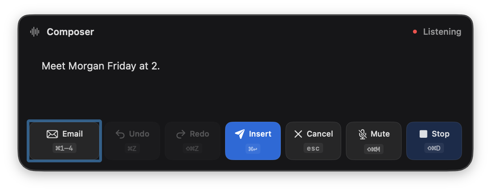
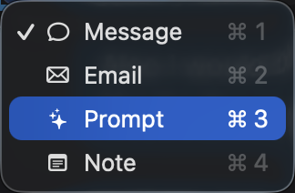

# Mac composer controls

The panel now has one action strip with Mode, Undo, Redo, Insert, Cancel, Mute, and Dictate/Stop. Each control shows its actual shortcut. Insert uses a paper-plane glyph and the primary accent; secondary actions share rounded surfaces, hover/pressed feedback, and disabled states. The compact status header and adaptive document height retain the existing notch-safe placement and rounded fallback panel.

| Action | Panel shortcut |
| --- | --- |
| Writing mode | ⌘1–4; also shown in the native icon/checkmark menu |
| Undo | ⌘Z |
| Redo | ⇧⌘Z, disabled because document Redo is not implemented |
| Insert | ⌘↩ |
| Cancel | Esc |
| Mute / Unmute | ⇧⌘M |
| Dictate / Stop | ⇧⌘D |

Opening preserves the captured editor. Clicking the panel gives it keyboard focus; these shortcuts belong to that panel and add no global interception. The existing global dictation hotkey remains unchanged. Undo uses the session's exact remaining transaction availability and disables after consumption. Mode inventory and shortcut labels follow the enum count.

## Actual native verification

The development-signed Mac build passed. Four existing notch geometry checks and the existing Undo regression with availability assertions passed. No full suite was repeated for this bounded Mac UI change.

Real CGEvent mouse and keyboard events, posted through the OS, exercised the running panel. They were not direct bridge calls to the shortcut actions:

- ⌘2 and ⌘4 changed modes; the final build additionally confirmed ⌘3 selected Prompt.
- ⇧⌘M muted and unmuted the same listening debug session without changing its ID or reporting errors.
- ⌘Z reversed a synthetic word pin (document revision 2→3); the consumed Undo then appeared disabled.
- ⌘↩ inserted the actual final rendered synthetic document into a disposable TextEdit document. TextEdit and the completed composer both contained `Hey, can we meet Morgan on Friday at 2?`, with status `done` and error empty. This is actual native field insertion, superseding the earlier clipboard-only limitation for this signed test identity.
- ⇧⌘D moved an empty debug session from listening to trailing; Esc then canceled it and hid the panel. Final state was idle, error empty, busy false, and microphone lease false.

Native event testing exposed Return being intercepted by SwiftUI's default-button handling. The panel now routes its local key events before its hosted view, and the repeated real ⌘↩ check passed. The mode picker uses AppKit NSMenu because SwiftUI transient popover presentation proved unreliable from the nonactivating panel.

The successful shortcut checks used debug transcription and short synthetic text without a microphone lease. Earlier native microphone/provider proof is in [composer-native-voice.md](composer-native-voice.md). One unexpected normal microphone session appeared during the first shortcut probe and was canceled immediately; fresh isolated same-session debug checks supplied the successful Mute evidence.

Only panel/menu crops are committed. Full desktop captures and raw Room logs remain local.

