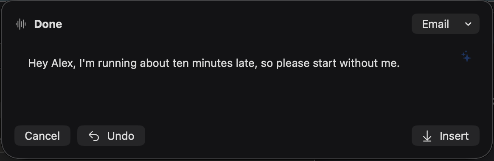
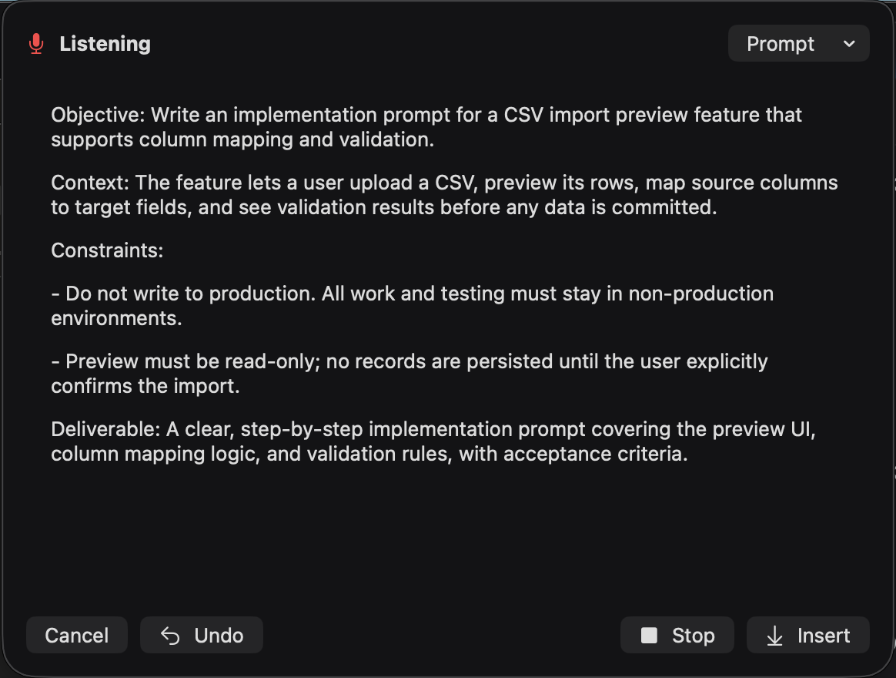

# Mac composer UAT — 2026-10-30

Real Claude sessions now complete without provider or tool-input errors. The Mac panel is compact for short drafts, expands to a bounded scroll area, uses an opaque dark surface, and has softly rounded top corners below the camera/menu-bar area. Automatic insertion into TextEdit remains blocked by the isolated app's missing Accessibility permission; clipboard fallback works. Issue #118 remains open for actual microphone input and joint user review.

## Runtime and scope

Development-signed native Mac build, bundle `de.gruenwald.legato.mac.composer-debug`, app `/Users/work/Library/Caches/legato/device-derived/6181592d8c70/Build/Products/Debug/Legato.app`, bridge `/Users/work/Library/Caches/Legato/composer-debug-bridge`. Launch flag `-LegatoDisableHotkeys YES` prevents ambient global shortcuts. Xcode 27.2 was available; pinned 26.6 was unavailable.

All three sessions used `debug.transcriber` with raw Soniox-format finalized tokens, English language, explicit timestamps and confidence. `microphoneLeaseActive:false`; no microphone audio or Soniox request was used. Finalized segments drove the real Claude clients and shared production session/room/tool path. A partial-only Message frame produced only the speculative tail: empty document, `busy:false`, no authoring request.

## Observed sessions

| Mode | Session | Observed outcome |
| --- | --- | --- |
| Message | `D874BFD0-C7E6-4F00-9D7A-AAB33AA77BCE` | “Hey Alex, I'm running about ten minutes late. Please start without me! 😊” Natural follow-up removed the emoji and produced one sentence while preserving the facts. |
| Email | `12A1EB91-0C9E-4AB9-BEB2-1BE5A75FA1EE` | “Hi Morgan, … Project Atlas review on Tuesday at 14:30. … bring the draft timeline?” Pick pinned `Atlas`; the following concise instruction was consumed, with name/time/project and pin preserved. Wording remained substantially unchanged. |
| Prompt | `C3A51D87-ACB5-425F-B938-FBE983553C9D` | CSV import preview, column mapping, validation, read-only preview and no production writes. Follow-up changed the structured prompt into a short checklist and retained every core constraint. |

Each reached `busy:false,error:""`. Active Message→Email mode change reformatted the document into greeting/body/sign-off without an API error. Undo restored the previous single sentence. Stop entered `finalPass` and then `done`. Prompt Stop followed immediately by `composer-insert-host` accepted the captured checklist, cancelled remaining work and returned `done,busy:false,error:""`; this establishes host acceptance, separately from native field delivery.

A tap followed by a seven-word low-confidence correction was treated as ordinary content and subsequently consumed as an instruction. It does not establish direct spoken-hint binding: that path accepts only one to three words. Low-confidence popover interaction and direct short spoken-hint binding remain unverified in this Mac run.

## Native insertion gap

TextEdit was frontmost with a caret in a new unsaved document before debug-start captured the target. `composer-insert` hid the panel and copied the exact composed text, but TextEdit remained empty. The app itself displayed: “Copied to the clipboard. Grant Accessibility to type into fields.” The full-screen evidence is `insert-fallback-full.png` in the private evidence directory. Required consent is System Settings → Privacy & Security → Accessibility for the isolated app path above. No TCC bypass or permission change was performed. Actual field delivery and other editors remain unverified.

## Visual inspection

Whole-monitor captures were opened and inspected, including the surrounding native desktop, target caret, menu bar, panel corners and all controls. The initial 580×360 empty slab showed underlying desktop text through its black surface and had a hard flat top edge. The updated body starts at 188 points, grows to at most 440 points within the screen's available area, and keeps its top edge stable. Short Message, Email paragraphs, long Prompt content and a long partial-only transcript were inspected. Text wraps inside the panel, longer input scrolls, controls remain reachable, and the opaque background eliminates text bleed. Provider errors are bounded to two visible lines with the full error available through help.

Only opaque panel crops are committed. Full desktop captures, including the before image whose transparency exposes background content, remain private under `/Users/work/Library/Caches/Legato/mac-uat-evidence/`: `before-empty-full.png`, `after-empty-full.png`, `after-long-partial-full.png`, `after-pending-full.png`, `after-email-full.png`, `after-prompt-full.png`, `after-checklist-full.png`, `insert-fallback-full.png`. The committed short capture follows active mode change and Undo, so it shows the Email menu with restored Message wording.

## Defect and checks

The first real Message run (`CA130DDD-BE2B-4BC0-9317-A3DE6D6A53B2`) exposed an empty `input_json_delta` on the parameterless `view` tool. The runner tried to decode an empty string and aborted with JSON unexpected EOF. Room sequence 455–460 records the initial `{}`, empty delta and error. The fix preserves the initial input for empty or whitespace deltas; malformed nonempty JSON still throws. A regression feeds the captured shape through byte-level SSE parsing, the runner, actual view tool execution and the next request's `tool_result`. It failed before the fix and passed afterward.

Checks: signed native Mac compilation passed; all four `NotchGeometryTests` passed; all seven affected Agent tests passed, including three empty/whitespace/truncated-input cases. Logs are `geometry.log`, `empty-input-red.log`, `empty-input-green.log` in the private evidence directory. Full integration gate belongs to the epic integration session.

Private full state snapshots are `states.jsonl` in the same evidence directory. Provider traces and source-input evidence are `/Users/work/Documents/sessions/<sessionID>/room.jsonl`; these include `input.source`, full injected frames, requests, streamed events and tool results. No credentials were printed or committed.
