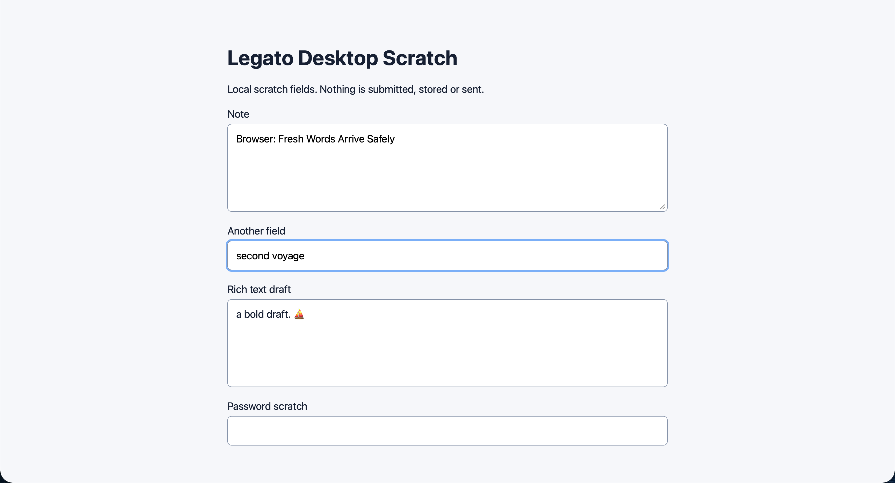

# Mac field dictation and Magic acceptance

Local offline agent acceptance passed on source `fd2b682`. The app was built with Xcode 27.2 on macOS 26.6.2 and run under an isolated bundle identity, preferences, history and bridge. The installed app remained running and unchanged.

## Observed behavior

- TextEdit: live partials appeared and revised at a middle cursor, preserving the surrounding text. Finalized speech and a cleanup fixture updated the same span. Selected text was rewritten, and the native Undo button restored it exactly.
- Safari textarea: selected `Quiet harbor. ⛵` became `QUIET HARBOR. ⛵`; native Undo restored the original. Finalized dictation changed `Browser: ` to `Browser: fresh words arrive safely`, then the cleanup fixture changed that same span to `Browser: Fresh Words Arrive Safely`.
- Safari single-line input: dictated text replaced the selected passage; Magic rewrote it in place without affecting the other scratch fields.
- Safari contenteditable: `A Bold Draft. ⛵` became `a bold draft. ⛵`.
- Native controls: actual key events started and stopped dictation and Magic. Native Undo and Accept worked. After the final fix, clicking native Run applied `Second voyage` → `SECOND VOYAGE`, and the very next Magic key press began a new instruction; its matching stop produced `second voyage`. Accept returned the app to idle.
- The indicator stayed small and nonactivating, retaining the browser as its target. No separate composer appeared.

The conductor independently read the final Safari input as `second voyage`, checked the corresponding before/after history records and confirmed idle instruction state. The tester worked interactively against actual fields and native controls, using the bridge for synthetic speech rather than a scripted acceptance driver.

## Findings fixed

Opening Magic initially exposed a native window-constraint feedback loop. The manually sized indicator now disables automatic hosting-view size negotiation. Safari advertised a selected-text setter that returned success without changing text; its adapter now uses an advertised scoped text operation, checking the selected range, marker text, bounds, exact replacement and final caret. Native Run initially consumed the next Magic shortcut; Run now uses the controller action that also resets gesture state.

## Checks and limits

The focused package run passed 42 tests in seven suites. A strengthened failed-stream retry regression also passed, as did the internal-exclusion fixture checks. Final Mac Debug and ordinary Release builds passed; the Release scan confirmed that both Mach-O files exclude internal controls and fixtures. The protected merge queue owns the full package and both-app gate.

This proves local native field routing and controls with synthetic speech and deterministic model fixtures. Real microphone capture, speech recognition, provider interpretation, all other editors and a published release are separate evidence. Paste-only fallback safety was covered by focused checks; no general compatibility claim is made for untested hosts. Production default bindings were checked separately; runtime key events used isolated F18/F19 bindings to avoid triggering the installed app. Partial-only synthetic tails without a final recognizer event are not real-speech completion evidence. Full private reports and logs remain under `/tmp/legato-mac-field-uat/`.
