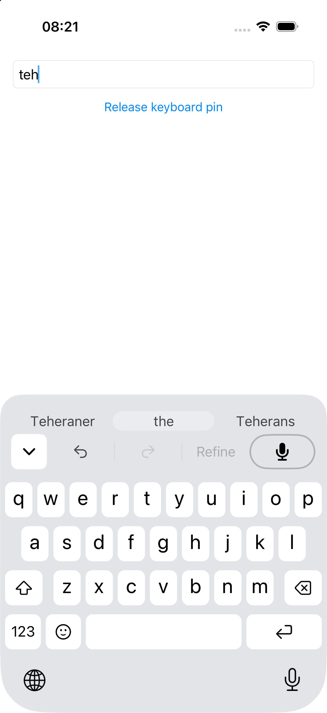
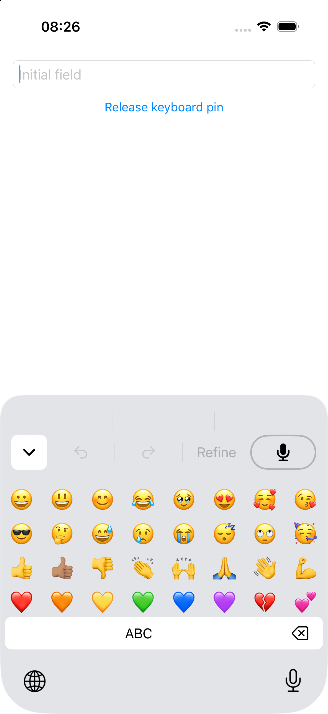
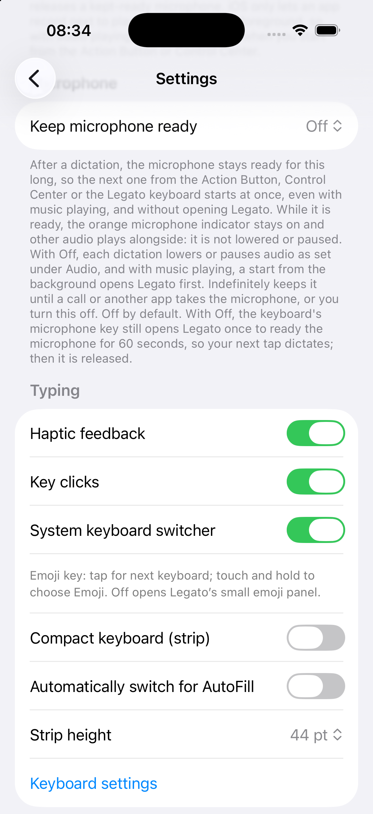
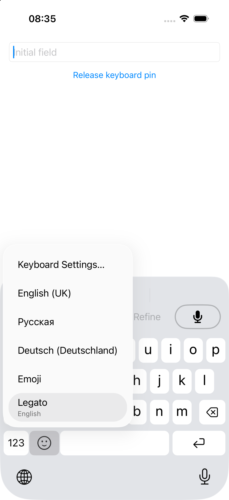
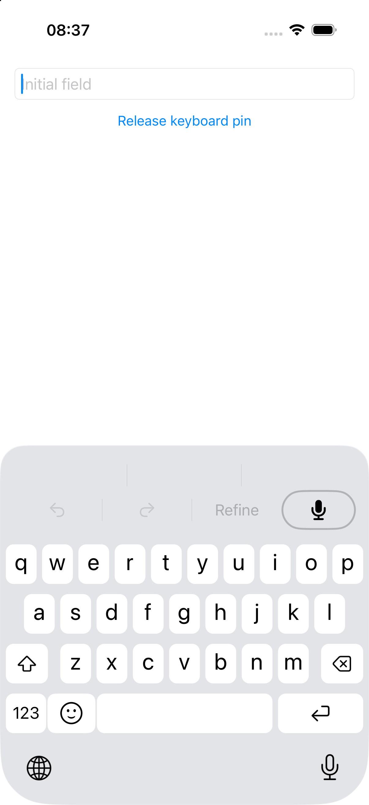

# Keyboard behavior — 29 October 2026

The real iOS keyboard extension offers spelling corrections only on tap, opens a local emoji panel by default, and shares an optional native-switcher preference with the app. The native option uses Apple's standard interaction: tap advances to the next keyboard; hold opens the chooser. It does not select Emoji automatically.

Checks used a dedicated iPhone 17 simulator on iOS 26.5, portrait 402 × 874 pt. The final app and extension were built from an immutable source snapshot with `LEGATO_STUB_DEPS=1`. Native dictionaries, UIKit, keyboard extension and text proxy were real; dictation/model engines were stubbed. The settings screen used simulated readiness without recording audio. These checks do not establish physical-device dictation behavior.

| Interaction in the real extension | Observed result |
| --- | --- |
| Type `teh` using software-key taps, then wait | Field remains `teh`; `the` appears in a persistent correction capsule. |
| Tap the center correction | Field becomes `the `, including the trailing space. |
| Retype `teh` and press Space without tapping a suggestion | Field remains `teh `. |
| Delete that space and type punctuation without accepting | Field becomes `teh.`. |
| Open local panel, select 😀 then 👍🏽 | Field becomes `😀👍🏽`. |
| Press panel Delete once | Field becomes `😀`; the skin-tone sequence is deleted as one grapheme. |
| Press ABC, then type `a` | Letter keyboard returns; field becomes `😀a`. |
| Enable System keyboard switcher in the app, terminate the app and extension, then reopen | The separately running extension reads the saved preference. |
| Tap the configured smiley control | iOS switches to an enabled native German keyboard. |
| Hold the configured smiley control | Apple's chooser lists the enabled keyboards, including Emoji and Legato. |
| Select Legato through Apple's chooser, then Emoji through the configured control, then native ABC | Returns to Legato. This uses normal system keyboard history, not the test host's input-mode pin. |

The simulator requires the declared App Group entitlements for a real settings roundtrip. An unsigned build stores the suite separately per process and cannot establish sharing. The final check used:

```sh
LEGATO_STUB_DEPS=1 xcodebuild build -project Apps/iOS/Legato.xcodeproj -scheme Legato -configuration Debug -destination 'platform=iOS Simulator,id=BF601895-00FF-449A-9AF1-12FCE1DB811A' CODE_SIGN_IDENTITY=- CODE_SIGNING_ALLOWED=YES CODE_SIGNING_REQUIRED=YES CODE_SIGN_STYLE=Manual DEVELOPMENT_TEAM= ARCHS=arm64 ONLY_ACTIVE_ARCH=YES
```

Generate the project first with the pinned XcodeGen. The retained scratch build used `/tmp/legato-4-geometry/source` and `/tmp/legato-4-geometry/derived`; the source snapshot also carries the documented DEBUG-only rotation host. For keyboard switching, launch with `-LegatoKeyboardHarness YES -LegatoHarnessSystemField YES -LegatoHarnessAutocap NO -LegatoHarnessSingleField YES -LegatoHarnessUnpinKeyboard YES`. A forced input-mode pin prevents a realistic switch/history check. Use actual software-key taps; hardware text injection can change simulator keyboard mode.

Final affected package command passed **553 tests in 59 suites**:

```sh
LEGATO_STUB_DEPS=1 swift test --filter 'LegatoVocabularyTests|LegatoKeyboardCoreTests'
```

This includes real-defaults layout/preference recreation, suggestion kinds and bilingual/vocabulary exclusions, frozen proposal identity, Unicode palette and field policies. Stale touch identity is covered by unit checks; a live asynchronous row-replacement-during-touch drive remains unproven. Broad suites and both app builds remain the merge-queue gate. The [geometry report](keyboard-geometry-2026-10-29.md) records native comparisons, cold full/compact restoration and remaining font/device gaps. The [suggestion research](../research/ios-keyboard-suggestions.md) records native correction emphasis and local-model findings; it does not claim a production context-model upgrade.

| Correction proposal | Local emoji panel | Native option |
| --- | --- | --- |
|  |  |  |

| Apple's chooser from the configured key | Native ABC returns to Legato |
| --- | --- |
|  |  |
