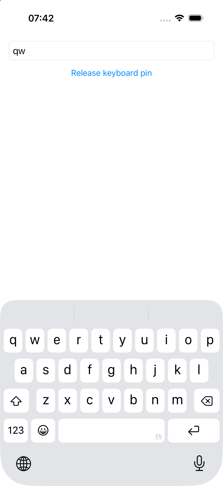
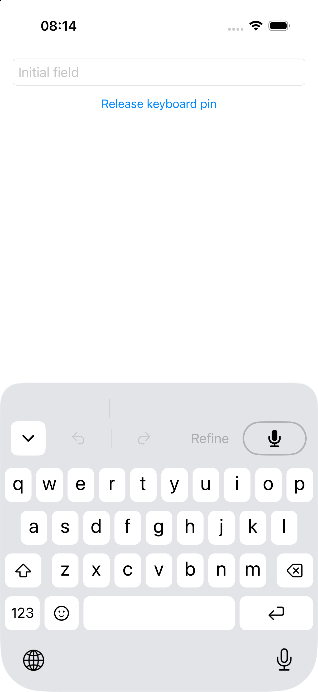
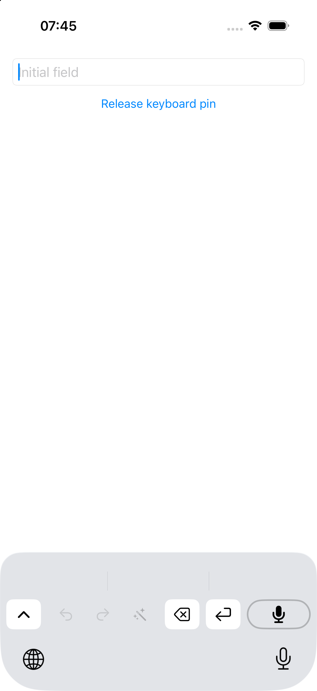
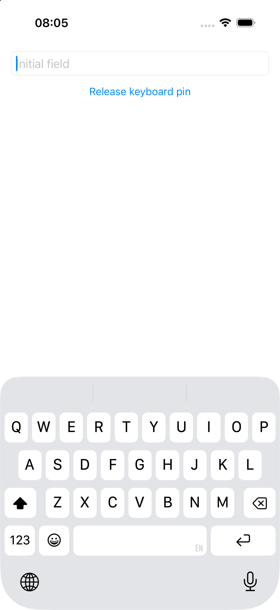
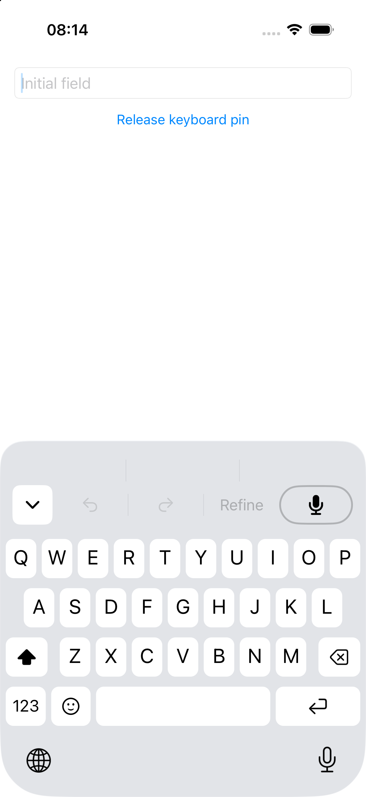
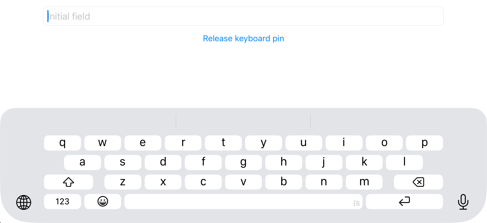
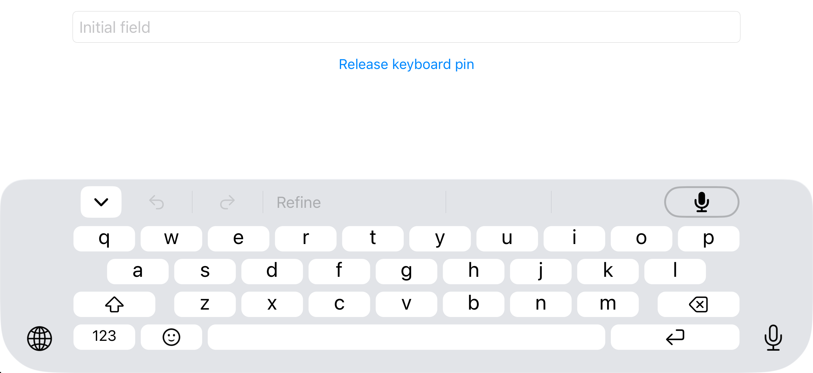
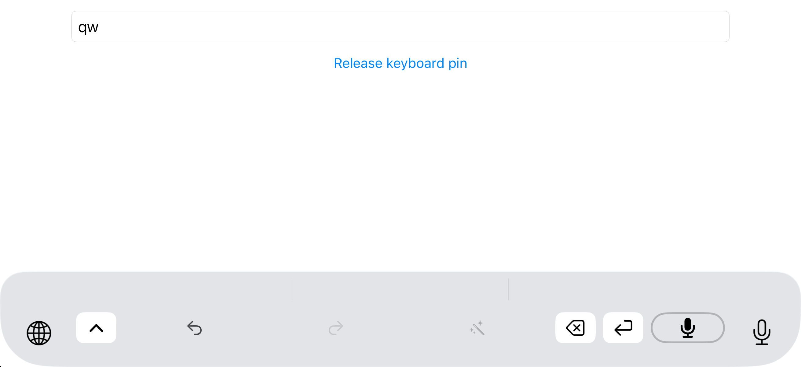

# Keyboard geometry — 29 October 2026

Native comparisons found three visible problems: portrait key rows were 7 pt too high, portrait capital letters were too large and reached 2⅓ pt too high inside their faces, and landscape added the system's side insets a second time. The corrections align the key faces in both orientations and the measured letter top/bottom edges. Glyph widths are not identical to Apple's font; the remaining uppercase width discrepancy is retained explicitly.

Device: dedicated `legato-4-geometry` iPhone 17 simulator (`BF601895-00FF-449A-9AF1-12FCE1DB811A`), iOS 26.5, 3× screenshots, light appearance. Portrait is 402 × 874 pt; landscape is 874 × 402 pt. Native English and Legato were switched in the same ordinary nonsecure `SystemFieldHost` field with autocorrection and capitalization disabled. Legato captures show the actual installed extension, not the in-app keyboard rendering harness. Native captures were inspected to confirm the system suggestion bar and matching English layout.

The first portrait baseline came from the previously installed cached Debug app. Final captures came from fresh Debug builds in an immutable source snapshot. `LEGATO_STUB_DEPS=1` replaced model engines; these checks establish keyboard layout and touches, not dictation/audio behavior. For landscape only, a scratch host enabled supported orientations and used public `UIWindowScene.requestGeometryUpdate`. The small [host patch](keyboard-geometry-2026-10-29/rotation-host.patch) is retained for reproduction; it does not alter the shipped host.

| Portrait key face | Native | Before | Final |
| --- | --- | --- | --- |
| First row, screen y | 591–634 pt | 584–627 pt | 591–634 pt |
| Second row | 645–688 pt | 638–681 pt | 645–688 pt |
| Third row | 699–742 pt | 692–735 pt | 699–742 pt |
| Bottom row | 753–796 pt | 746–789 pt | 753–796 pt |
| Row pitch / face height | 54 / 43 pt | 54 / 43 pt | 54 / 43 pt |
| Gap above system-owned bottom area | 3 pt | 10 pt | 3 pt |

The portrait requested height changed from 306 to 299 pt; every row edge now matches at pixel resolution. First-row face x edges differ by at most ⅓ pt at a scanline 5 pt below the key top. Native accessibility cells include inter-key gaps (Q is 39⅓ × 54 pt), whereas Legato's key accessibility rectangles describe drawn faces; these are different quantities.

Portrait lowercase ink already matched the native vertical placement within ⅓ pt after correcting the whole-row offset. Capitals used the same 25 pt font as lowercase: W/E/R/A/D began 10⅓ pt below the face top instead of native 12⅔ pt, with the same 28 pt baseline. Capitals now use 22 pt and retain that baseline; lowercase remains 25 pt, and uncased symbols retain their original size. Final capital ink top/bottom edges differ from native by at most ⅓ pt across the first two letter rows. Widths still differ by up to 1⅔ pt for Q/O/G. The full-dimension comparison intentionally remains **FAIL** for that width discrepancy; the explicit vertical-only glyph contract passes. No font-family or horizontal compression change was guessed to hide it.

| Landscape measurement | Native | Before | Final |
| --- | --- | --- | --- |
| First face x, near rounded top | about 80 pt | about 155 pt | within ⅓ pt of native |
| First row, screen y | 244–271⅓ pt | 241⅔–267 pt | 243⅔–271 pt |
| Second row | 279⅓–306⅔ pt | 277–302⅓ pt | 279–306⅓ pt |
| Third row | 314⅔–341⅔ pt | 312⅓–337⅔ pt | 314⅓–341⅔ pt |
| Bottom row | 349⅔–377 pt | 347⅔–373 pt | 349⅔–377 pt |

Landscape iOS gives the extension a 724 pt content window inside the 874 pt screen, with 75 pt already supplied on each side. Subtracting those observed insets from the existing 79 pt screen margin leaves 4 pt inside the window. A full-width 874 pt harness keeps its 79 pt margin. The pure geometry tests also cover different screen/content width pairs, missing screen metadata and a rotated harness whose content is wider than its window. Drawing, touch frames, top controls and globe placement receive the same screen geometry.

Landscape key faces are now 27.33 pt high, with the existing 35.33 pt pitch and 51 pt first-row offset, and 4 pt below the last face. The requested height is approximately 188 pt and was granted by iOS. The landscape letter baseline moves from 18.3 to 19.3 pt based on native lowercase ink: final ink top/bottom edges differ by at most ⅔ pt. First-row x edges and all four row edges differ by at most ⅓ pt. Matching landscape uppercase ink was not established by this run; no separate uppercase landscape parity claim is made.

Compact has no native compact counterpart. Its 84 pt content area ends at the same system-owned bottom boundary (portrait y = 799 pt, landscape about y = 381 pt): 40 pt word row plus 44 pt control row. Portrait faces occupy y = 758–796 pt (38 pt), with 3 pt top/bottom inside the touch row. The full native bottom row ends at the same y = 796 pt; compact intentionally uses smaller centered faces. Landscape compact was also captured and touched after the inset fix.

Real touch and persistence checks passed:

- Portrait full centers `(24,612)`, `(62,612)`, `(200,770)` inserted `qw `. Above-face/inter-key/below-face contacts `(24,588)`, `(42,612)`, `(200,798)` inserted `qq ` in an empty field.
- Portrait compact delete `(210,756)`, above the visible face, changed `qw ` to `qw`. Chevron taps changed modes, downward swipes collapsed, and explicit AXe touch-move drags expanded from the chevron and empty word-row background.
- Landscape full `(112,257)`, `(184,257)`, `(440,365)` inserted `qw `. Collapsing and tapping compact delete `(604,338)`, outside the visible face, changed it to `qw`.
- Terminating keyboard extension and host with `simctl terminate` produced new extension processes that restored full (PID 39659, requested/granted 299) and compact (PID 39739, requested/granted 84); original PID 38722. This proves extension-local layout persistence across process recreation. These cold-reopen checks preceded the later landscape/font changes.

High-level `axe swipe` was unreliable for upward expansion from empty backgrounds; explicit `axe drag` worked. Slow Debug drags can trigger the existing strip-height long press, so reset `keyboardStripHeight=44` before collecting standard compact evidence. Simulator preferences retained are `keyboardStrip=YES`, `keyboardStripHeight=44`.

Test-first evidence: the portrait unit regression failed at y = 584 instead of 591; the landscape unit regression failed by over 2 pt; the screenshot negative controls caught the 7 pt portrait offset, 75⅓ pt landscape x error and 2⅓ pt uppercase ink top error. After correction all nine geometry tests passed. The affected keyboard-core target passed 548 tests in 57 suites; this shared-worktree run also picked up the concurrently added correction-tap test. The final combined correction/geometry gate is recorded separately by the parent session. This is one affected package target, not the full package suite. The fresh simulator build, shell syntax check, Ruff and strict Pyright checks passed. Historical exact height assertions were updated only after native measurements established the new alignment requirement.

Repeat the retained comparisons from the repository root:

```sh
uv run scripts/e2e/keyboard-geometry.py docs/validation/keyboard-geometry-2026-10-29/native.png docs/validation/keyboard-geometry-2026-10-29/full.png
uv run scripts/e2e/keyboard-geometry.py docs/validation/keyboard-geometry-2026-10-29/native-uppercase.png docs/validation/keyboard-geometry-2026-10-29/uppercase.png --glyph-dimensions vertical
uv run scripts/e2e/keyboard-geometry.py docs/validation/keyboard-geometry-2026-10-29/landscape-native.png docs/validation/keyboard-geometry-2026-10-29/landscape-full.png --glyph-dimensions vertical
LEGATO_STUB_DEPS=1 swift test --filter LayoutKeyboardHeightsTests
bash -n scripts/e2e/ios-sim.sh
ruff check scripts/e2e/keyboard-geometry.py
uv run --with pyright==1.1.408 --with pillow==12.1.1 pyright --pythonversion 3.14 scripts/e2e/keyboard-geometry.py
```

The helper pins Python 3.14.5 and Pillow 12.1.1. It detects white face bands separately from dark letter ink in the first two rows, excludes rounded borders and popups, and measures ink top/bottom/width relative to each face. Captures must have matching layout and case; image aspect ratio and key counts are checked. The 1 pt tolerance is unchanged. `--glyph-dimensions vertical` explicitly checks ink y while reporting width; omitting it also gates width. `uppercase-full-dimensions.json` retains the expected remaining failure. Replacing final images with `before.png`, `uppercase-before.png` or `landscape-before.png` reproduces the corresponding negative controls. JSON artifacts retain all raw measurements.

The build used `xcodegen generate` followed by `LEGATO_STUB_DEPS=1 xcodebuild build -project .../Apps/iOS/Legato.xcodeproj -scheme Legato -configuration Debug -destination 'platform=iOS Simulator,id=BF601895-00FF-449A-9AF1-12FCE1DB811A' -derivedDataPath .../derived CODE_SIGNING_ALLOWED=NO ARCHS=arm64 ONLY_ACTIVE_ARCH=YES` in `/tmp/legato-4-geometry/source`. Detailed build, RED/GREEN and runtime logs are under `/tmp/legato-4-geometry/`.

Remaining validation: other phone sizes, physical devices, restoration while typing in a second host app, matching landscape uppercase ink, and the remaining font-width differences. Broader geometry/persistence acceptance stays open where these exceed the proven simulator checks.

| Native portrait | Final full portrait | Final compact after cold reopen |
| --- | --- | --- |
|  |  |  |

| Native capitals | Final capitals |
| --- | --- |
|  |  |

| Native landscape | Final full landscape | Final compact landscape |
| --- | --- | --- |
|  |  |  |
