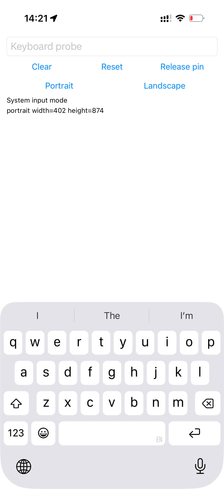
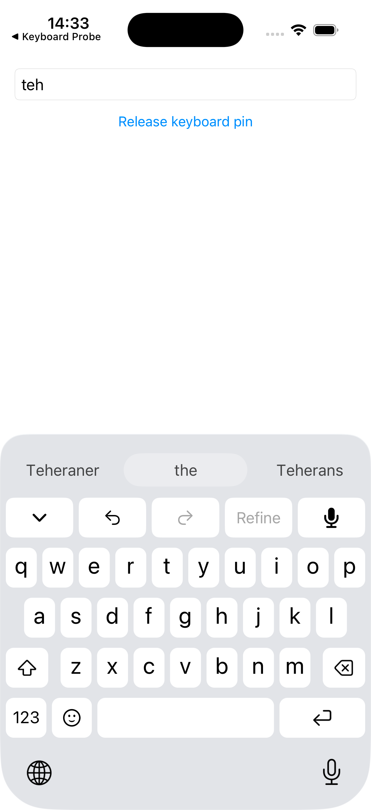
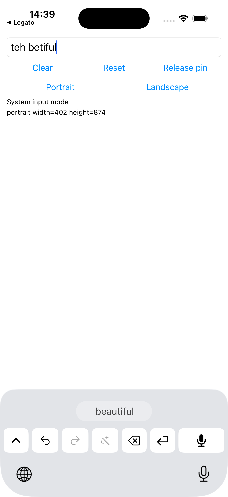
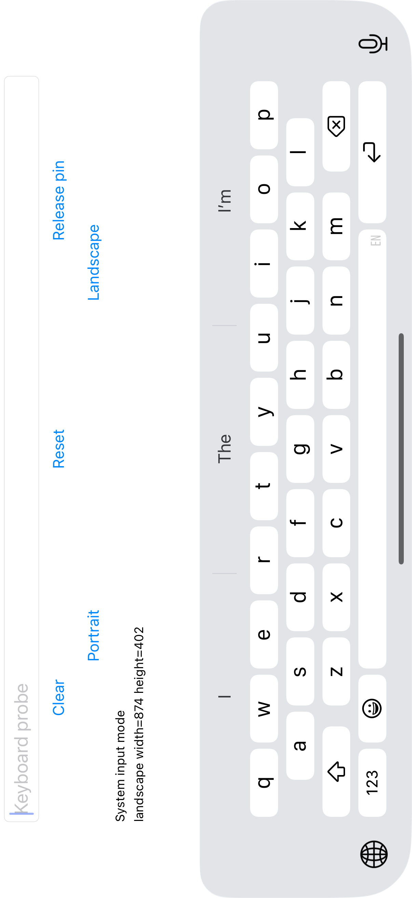
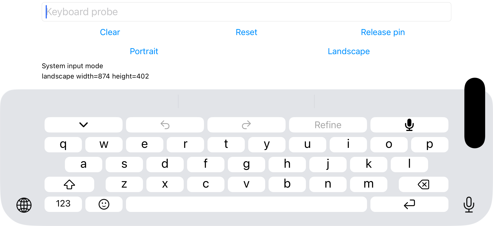
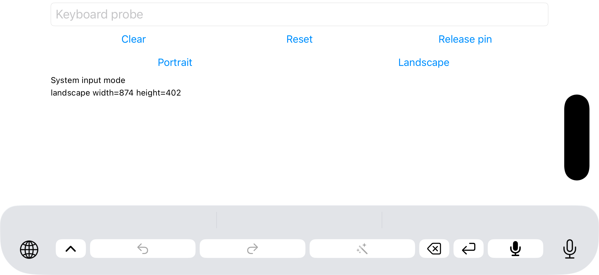

# Native prediction and tool rows — 29 October 2026

The full keyboard now places a native-sized prediction row above one tool key row, followed by the typing grid. Compact contains only predictions and one tool key row. The typing keys retain their previous native alignment. This supersedes the top-area and compact dimensions in the [earlier geometry report](keyboard-geometry-2026-10-29.md).

| Layout | Predictions | Tool face | Total requested height |
| --- | --- | --- | --- |
| Full portrait | 44 pt | 43 pt; 54 pt pitch to letters | 314 pt |
| Compact portrait | 44 pt | 43 pt; 8 pt above, 3 pt below | 98 pt |
| Full landscape | 44 pt | 27.33 pt; 35.33 pt pitch to letters | 222.65 pt |
| Compact landscape | 44 pt | 27.33 pt; 6 pt above, 4 pt below | 81.33 pt |

Predictions span the entire extension width, with three equal slots on the measured phone. Full tool keys share equal widths and native rounded faces. Compact uses 6.33 pt margins and 6 pt gaps; its undo/redo/Refine budget includes their internal gaps, retaining at least 30 pt per button across 320–932 pt test widths. Stored experimental 44/56 pt strip settings resolve to the new 54 pt portrait standard. The existing debug-only 0/1/30 pt experiments remain available.

## Native reference and rendered checks

The physical iPhone 17 on iOS 26.6.1 showed Apple's prediction view at `(0, 539, 402, 44)` in portrait and `(75, 194, 724, 44)` in landscape. A dedicated UIKit field explicitly enabled autocorrection, spell checking and predictions; English (US) was selected through the native chooser. The physical portrait → landscape reference capture passed. These dimensions establish a 44 pt prediction row in both orientations.

Final Legato screenshots and touches use the actual keyboard extension in the dedicated iPhone 17 simulator on iOS 26.5. Model engines were stubbed; UIKit, dictionary suggestions, text proxy, keyboard layout and touches were real. An ordinary host field received `teh`; an explicit middle-slot tap produced `the `; collapsing and tapping compact Delete produced `the`. A second software-key replay produced `teh betiful`, preserving the requested tap-only behavior. Full → compact worked in landscape, and returning to portrait restored the portrait row dimensions. No microphone check ran during these layout checks.

| Comparison against the physical native reference | Portrait | Landscape |
| --- | --- | --- |
| Typing face row-edge difference | 0 pt | ≤⅓ pt |
| First-row face x-edge difference | ≤⅓ pt | ≤⅓ pt |
| Letter ink top/bottom difference | ≤⅓ pt | ≤1 pt |
| Letter ink width difference, reported separately | ≤1 pt | ≤1⅓ pt |

Landscape simulator images were rotated clockwise into the orientation requested by the host; physical captures retain their EXIF orientation. The geometry helper now honors that metadata and excludes the added tool row from its typing-row scan. Both changes first failed against real captures. The original 7 pt offset still fails the unchanged 1 pt tolerance.

## Prediction animation

The physical native recording contains 390 frames over 18.05 seconds, about 21.6 fps on average. New letters visibly grow and fade in from left to right; retained letters stay full size while sliding. In one `the` → `tell` transition, an incoming letter's normalized ink height rose from 34 to 38 pixels while its lower edge remained fixed. That establishes growth and its anchor, not Apple's hidden initial scale or exact easing.

Legato now uses left-to-right insertion, a restrained 0.85 → 1 baseline-anchored grow/fade, and a 180 ms ease-out. Existing retained-letter slides and right-to-left removal remain. Reduce Motion disables the glyph movement. A rendered simulator recording confirmed growth, insertion order and retained-letter movement without stuck glyphs or clipping. Exact timing parity remains unproven: simulator capture averaged about 16.2 fps, and the start scale/easing are approximations.

The retained [native clip](keyboard-native-rows-2026-10-29/native-prediction-motion.mp4) shows only Apple's prediction bar; the [Legato clip](keyboard-native-rows-2026-10-29/legato-prediction-motion.mp4) shows the corresponding simulator bar. Candidate ranking differs, so these demonstrate motion rather than semantic parity. No contextual LLM backend was added.

## Gate and limits

The final affected gate passed **556 tests in 59 suites**. Focused row contracts passed 70 tests in five suites, and glyph insertion-order contracts passed 13 tests; expected RED failures preceded implementation. A fresh review caught and resolved landscape compact spacing and narrow-strip hotkey width errors. Signed real-dependency iPhone app/extension and simulator app builds passed. Shell syntax, Ruff, strict Pyright and diff checks passed. Full package suites and app queue checks remain the merge-queue gate.

The signed temporary branch build, including the separate DEBUG bridge, was installed on the phone. Final updated-phone UI validation remains incomplete: one accessibility-based run could not discover the controls, another failed to establish its remote XCTest connection, and a later screenshot caught the app switcher rather than a usable keyboard screen. A successful screenshot test alone is not a layout pass. Physical speech, other phone sizes, landscape uppercase and remaining font-width differences are still outside this evidence; #4 remains open.

Repeat the retained geometry checks:

```sh
uv run scripts/e2e/keyboard-geometry.py docs/validation/keyboard-native-rows-2026-10-29/native-portrait.png docs/validation/keyboard-native-rows-2026-10-29/full.png --glyph-dimensions vertical
uv run scripts/e2e/keyboard-geometry.py docs/validation/keyboard-native-rows-2026-10-29/native-landscape.png docs/validation/keyboard-native-rows-2026-10-29/landscape-full.png --glyph-dimensions vertical
LEGATO_STUB_DEPS=1 swift test --filter 'LegatoKeyboardCoreTests|LegatoVocabularyTests'
```

| Native portrait, physical phone | Full Legato, simulator | Compact Legato, simulator |
| --- | --- | --- |
|  |  |  |

| Native landscape, physical phone | Full Legato, simulator | Compact Legato, simulator |
| --- | --- | --- |
|  |  |  |
