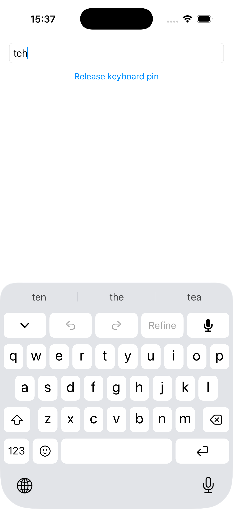
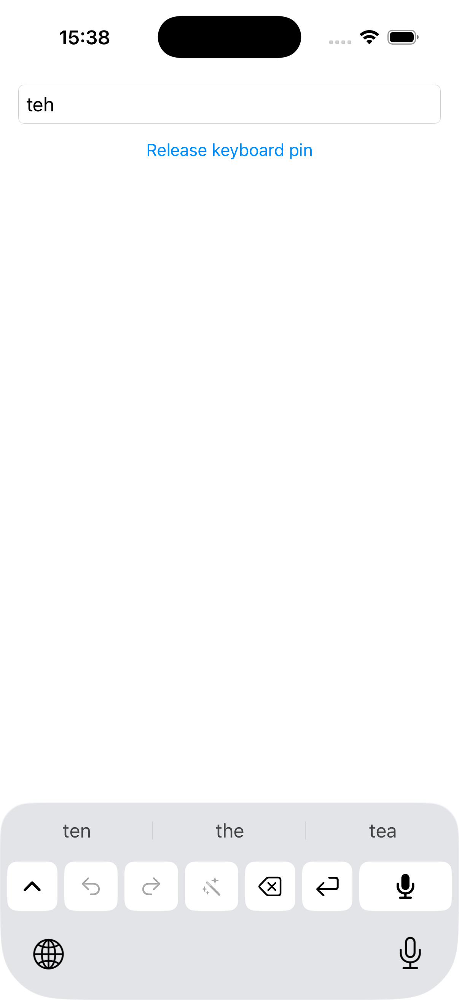
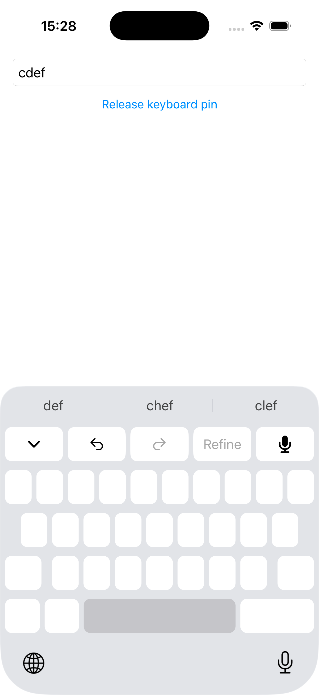
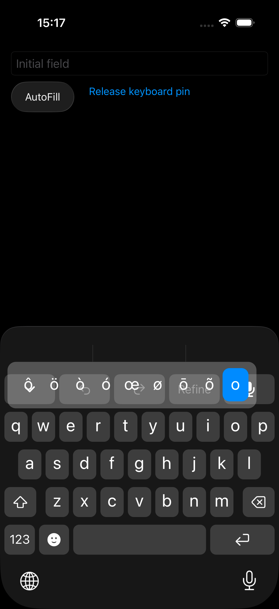
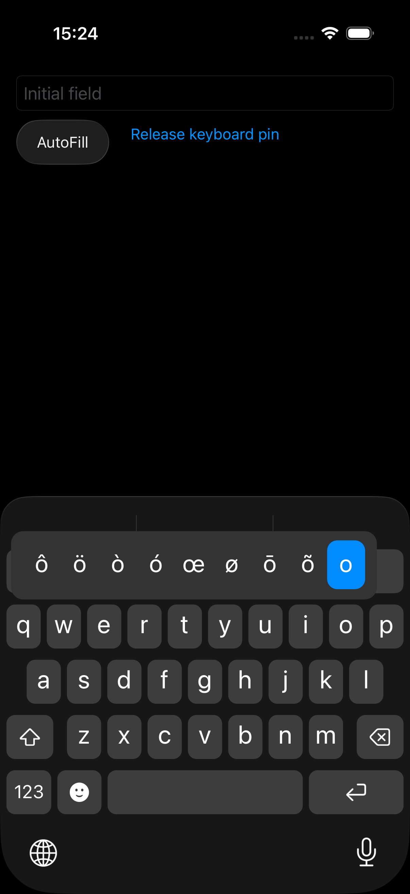
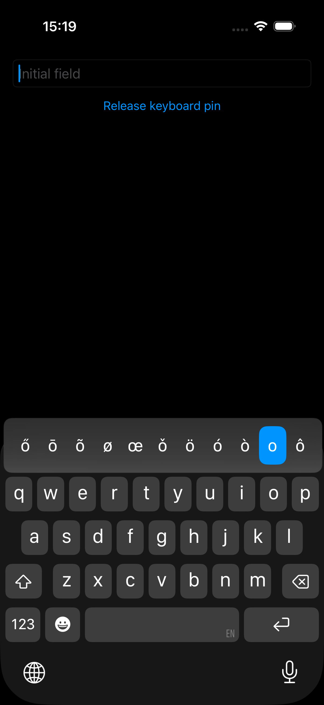
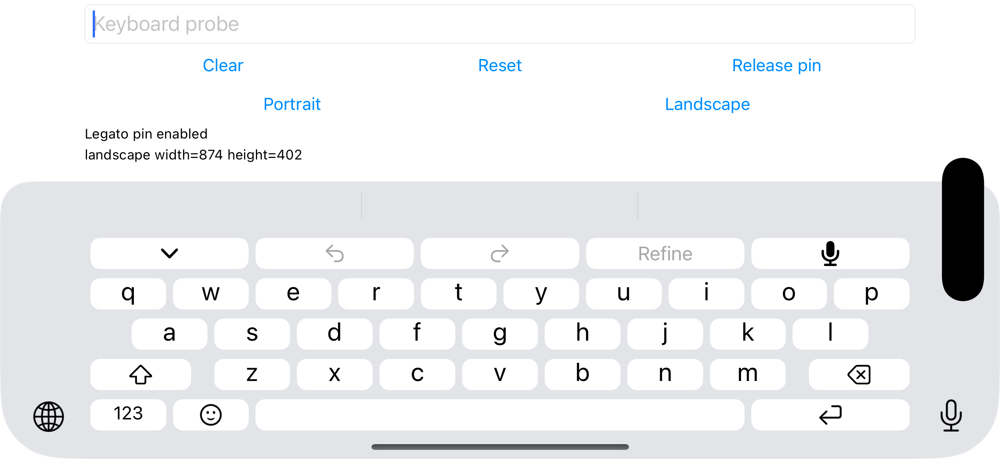

# Keyboard polishing — 29 October 2026

Portrait predictions now account for the system rounded top area, dark key popups cover the tools beneath them, and holding Space enables horizontal cursor movement. This supersedes the portrait height claims in the [previous row report](keyboard-native-rows-2026-10-29.md).

## Visible prediction geometry

On the measured iPhone 17 layout, iOS adds 17 pt above the portrait extension content. Requesting 44 pt for predictions therefore produced a visible 61 pt row. Apple's measured 44 pt prediction frame includes that rounded area. Removing SwiftUI safe areas and changing the public input-view style did not remove it; root, host and grid already reported zero safe insets.

| Layout | Prediction content requested | System top area | Visible predictions | Total extension height requested |
| --- | --- | --- | --- | --- |
| Full portrait | 27 pt | 17 pt | 44 pt | 297 pt |
| Compact portrait | 27 pt | 17 pt | 44 pt | 81 pt |
| Full landscape | 44 pt | 0 pt | 44 pt | 222.65 pt |
| Compact landscape | 44 pt | 0 pt | 44 pt | 81.33 pt |

Portrait word ink is raised 5.67 pt inside the content frame; its measured center is 509.67 pt, against the native-equivalent 509.83 pt. Separators follow the ink and shorten to remain inside the extension. Tools still begin at 537 pt and typing keys at 591 pt. Portrait typing row edges match the retained physical reference exactly; glyph vertical edges differ by at most ⅓ pt. Landscape row edges differ by at most ⅓ pt and glyph vertical edges by at most 1 pt. Both comparisons pass the unchanged 1 pt vertical tolerance; font-width differences remain reported separately.

The 17 pt allowance is measured on this iPhone layout, not a documented SDK constant or verification of every device. The system top area cannot host our controls. The portrait correction capsule is consequently smaller than Apple's 36 pt native capsule: it remains inside the 27 pt extension region. This is a visible approximation.

## Popup compositing

The old dark popup filled the transparent grid with white at 26% opacity. Clearing that grid did not remove the sibling SwiftUI tools underneath, so their icons appeared through both accent strips and ordinary letter callouts. Popup fill is now opaque. The dark surface uses #333, an approximation of a native dark capture whose material varied around RGB 48–51; light remains opaque white. Actual dark hold-o captures confirm the tool glyphs no longer bleed through the popup. The native material gradient is not reproduced.

## Hold Space to move the cursor

A 400 ms Space hold blanks the typing glyphs and gives feedback. Dragging left or right moves by graphemes at approximately 8 pt per step; releasing consumes the Space press, including a stationary hold. Quick taps retain the existing space and double-space behavior. Layout changes, cancellation, field changes and teardown end the gesture.

A transient pan-local text window tracks requested movement before the separate-process proxy catches up. It clamps to known text and never guesses UTF-16 offsets when directional context is unavailable. Selected text declines ambiguous cursor movement. The pan snapshot is not persisted. Apple's [public cursor-offset API](https://developer.apple.com/documentation/uikit/uitextdocumentproxy/adjusttextposition(bycharacteroffset:)) supplies horizontal insertion offsets; vertical visual-line panning and exact native acceleration are outside this implementation.

Two XCTest checks passed against the actual extension in the iPhone 17 simulator on iOS 26.5. The ordinary host field was seeded through the DEBUG-only `LegatoHarnessInitialText` option; subsequent movement and letter insertion used actual keyboard touches. Model engines were stubbed, while UIKit, proxy context and editing were real.

| Gesture | Observed field value |
| --- | --- |
| Seed `abcdef`; stationary Space hold | `abcdef` |
| Hold Space, drag 24 pt left, release, tap x | `abcxdef` |
| Hold Space, drag 24 pt right, release, tap x | `abcxdefx` |
| Seed `ab👩‍💻`; hold, drag 16 pt left, tap x | `axb👩‍💻` |
| Seed `hello`; double-tap Space | `hello. ` |

The executed [XCTest fixture](keyboard-polish-2026-10-29/KeyboardPolishTests.swift) and [result counts](keyboard-polish-2026-10-29/ui-results.json) are retained. These checks used XCTest `press(forDuration:thenDragTo:)`; AXe's `--pre-delay` waits before touch-down and is not hold-then-drag proof. A separate touch-down screenshot confirms blank glyphs during the active hold. Portrait full/compact and landscape rendering were also inspected.

## Checks and delivery limits

**570 affected tests in 60 suites passed**, along with simulator and signed real-dependency iPhone app/extension builds, shell syntax and diff checks. Expected RED assertions preceded height, cursor, stale-context, missing-context, echo-fence and subpixel-boundary fixes. Fresh review findings were fixed and rechecked. Full package and app queue checks remain CI's merge-queue gate.

The final phone installation failed with CoreDevice connection error 4000 and a Wi-Fi timeout. The physical phone remains on its previous temporary build; these new changes have not been validated or installed there. No microphone or speech check ran. Issue #4 remains open for its outstanding acceptance work. The signed scratch build also includes the separate DEBUG bridge; it is not a merged-main or released build.

Repeat the package and retained geometry checks:

```sh
LEGATO_STUB_DEPS=1 swift test --filter 'LegatoKeyboardCoreTests|LegatoVocabularyTests'
uv run scripts/e2e/keyboard-geometry.py docs/validation/keyboard-native-rows-2026-10-29/native-portrait.png docs/validation/keyboard-polish-2026-10-29/full.png --glyph-dimensions vertical
uv run scripts/e2e/keyboard-geometry.py docs/validation/keyboard-native-rows-2026-10-29/native-landscape.png docs/validation/keyboard-polish-2026-10-29/landscape-full.png --glyph-dimensions vertical
```

| Portrait full | Portrait compact | Active cursor hold |
| --- | --- | --- |
|  |  |  |

| Dark popup before | Dark popup after | Native dark reference, simulator |
| --- | --- | --- |
|  |  |  |


